# ChakibOS · Portfolio de Chakib Selhi

Portfolio en forme de **bureau rétro** : icônes, fenêtres déplaçables, terminal interactif, CV et barre des tâches.
Je suis étudiant au baccalauréat en informatique et génie logiciel à l'UQAM, orienté **cybersécurité et réseaux**,
et je cherche un **stage** dans ces domaines.

**Site :** [chakib-selhi.github.io](https://chakib-selhi.github.io)


## Fonctionnalités

- **Gestionnaire de fenêtres** écrit à la main : déplacement, redimensionnement, réduction, plein écran, pile de fenêtres et barre des tâches.
- **Applications** : À propos, Projets (explorateur de fichiers + fiche de chaque projet), Compétences, Activités (CTF et bénévolat), CV.pdf, Contact.
- **Terminal** avec ses commandes (`help`, `whoami`, `neofetch`, `ls`, `cat`, `open`, `skills`, `activities`, `github`, `stage`, `contact`, `lang`), complétion par Tab et historique.
- **Projets synchronisés avec GitHub** : chaque dépôt public apparaît automatiquement dans Projets, avec sa description, ses langages, ses sujets, ses statistiques et son README affiché dans le site. Un dépôt supprimé ou passé en privé disparaît du site. Les compétences et la pile technique se mettent à jour en même temps (API GitHub, requêtes conditionnelles, mode hors ligne).
- **Bilingue français / anglais** : bouton dans le menu Aide, changement de langue sans recharger la page. La langue du navigateur est détectée à la première visite.
- **Version simple** (`simple.html`) : tout le CV sur une seule page, lisible et imprimable, pour les recruteurs pressés.
- **Mobile** : chaque fenêtre devient une application plein écran.
- **Accessible au clavier** : Tab pour parcourir, Entrée pour ouvrir, Échap pour fermer la fenêtre active.
- **Aucune dépendance** : HTML, CSS et JavaScript, sans framework ni étape de compilation.

## Captures d'écran

| Projets | Fiche projet |
|---|---|
| 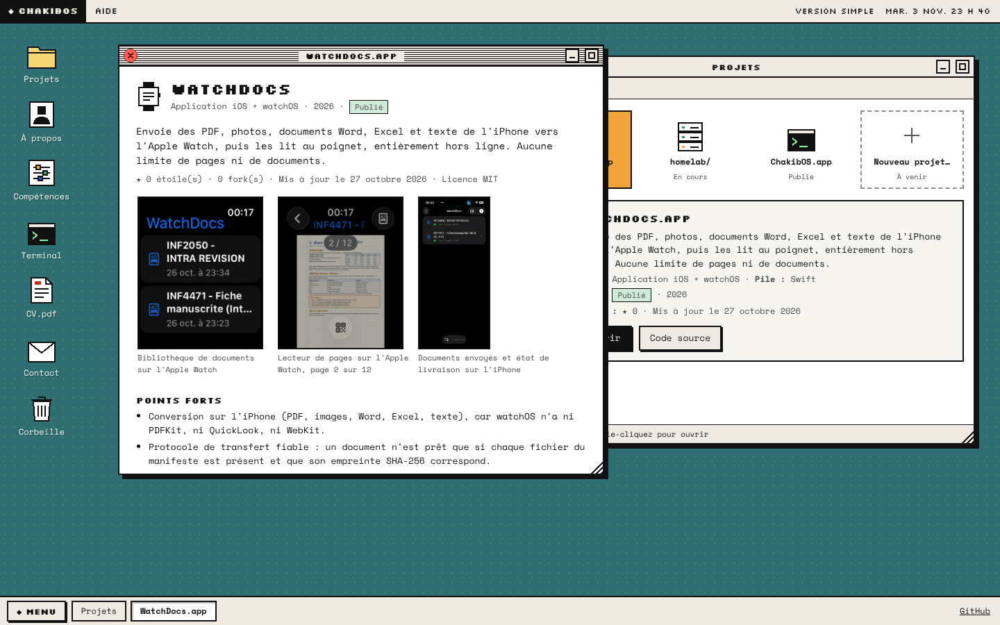 | 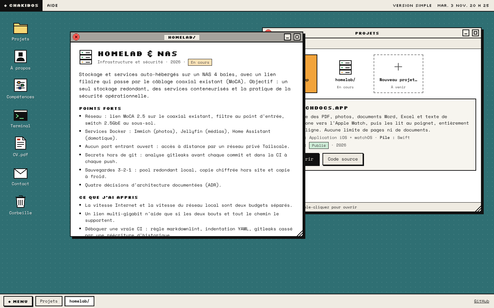 |
| **Compétences** | **Terminal** |
| 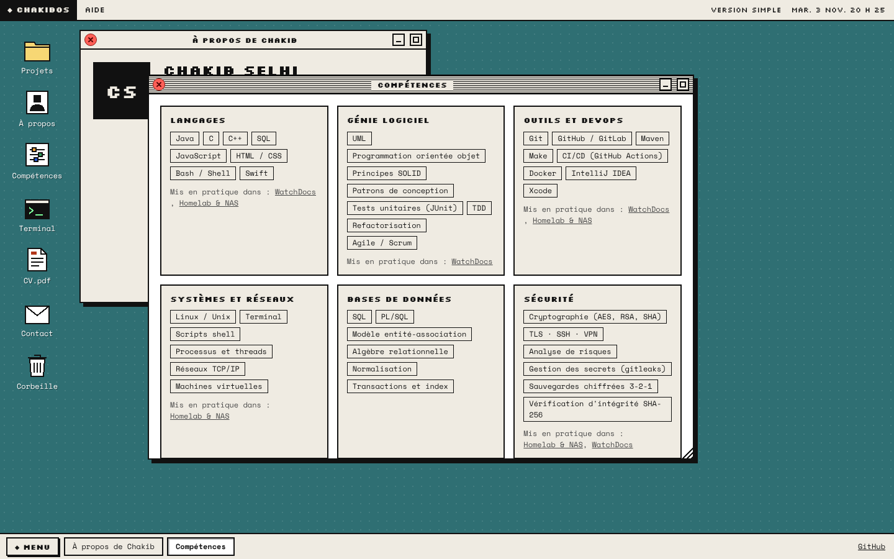 | 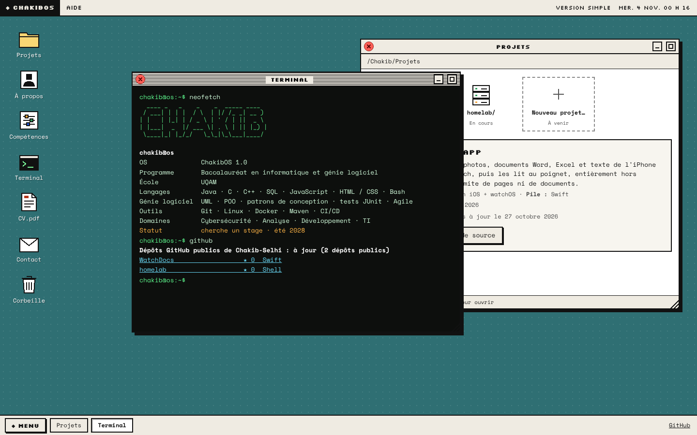 |
| **CV.pdf** | **Contact** |
| 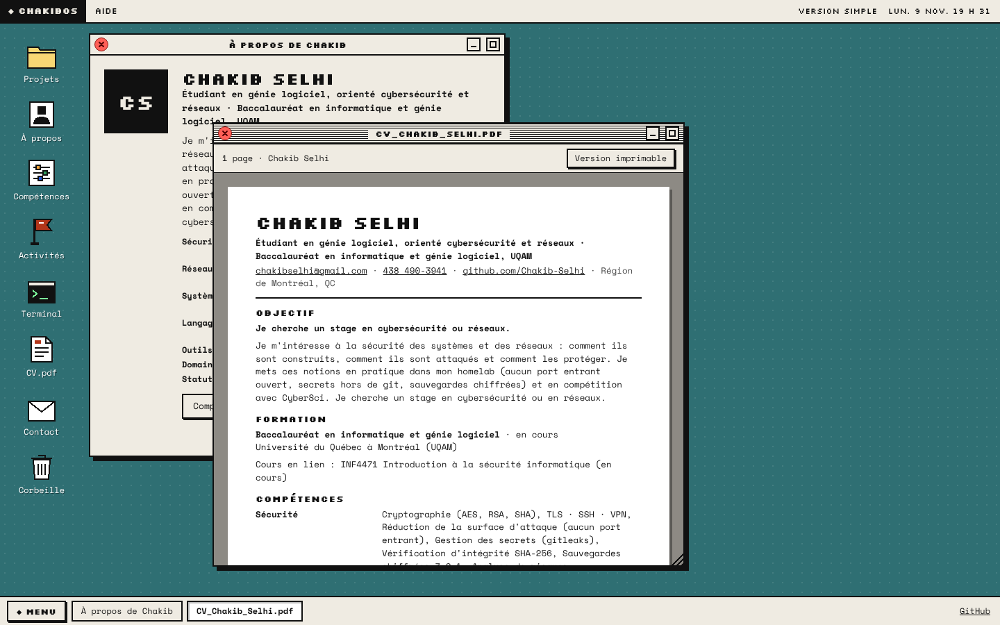 | 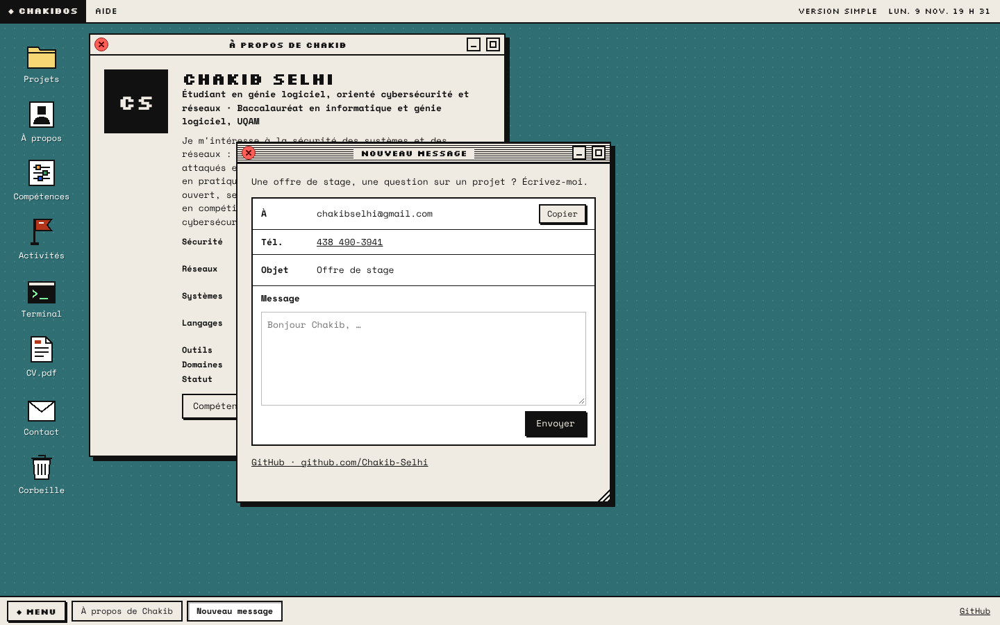 |
| **Menu Aide (langue)** | **Version simple** |
| 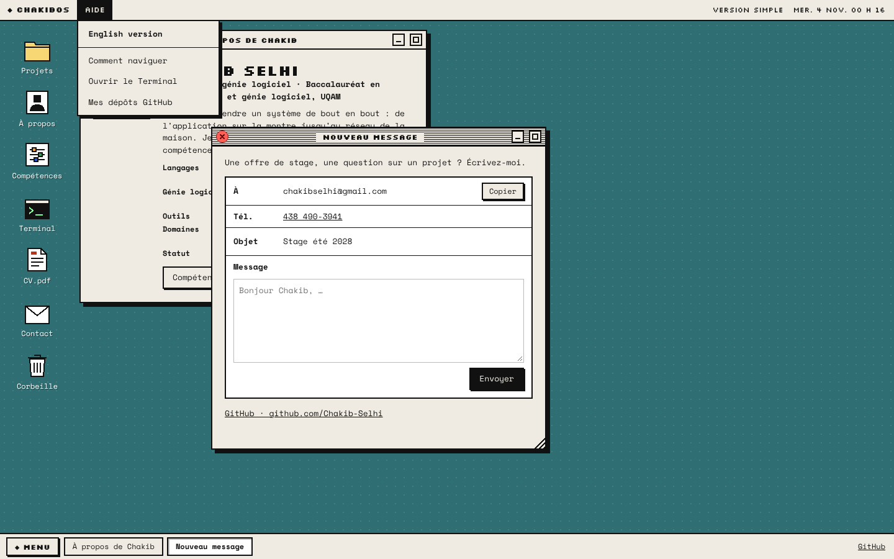 | 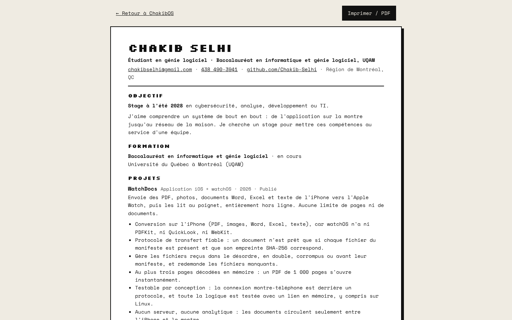 |
| **README d'un dépôt dans le site** | **Version anglaise** |
| 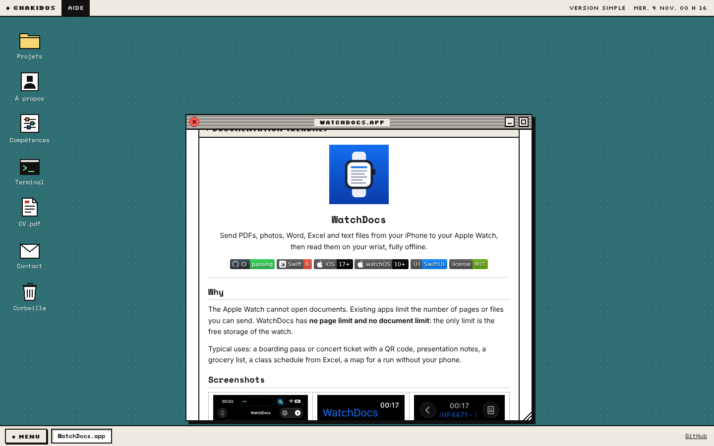 | 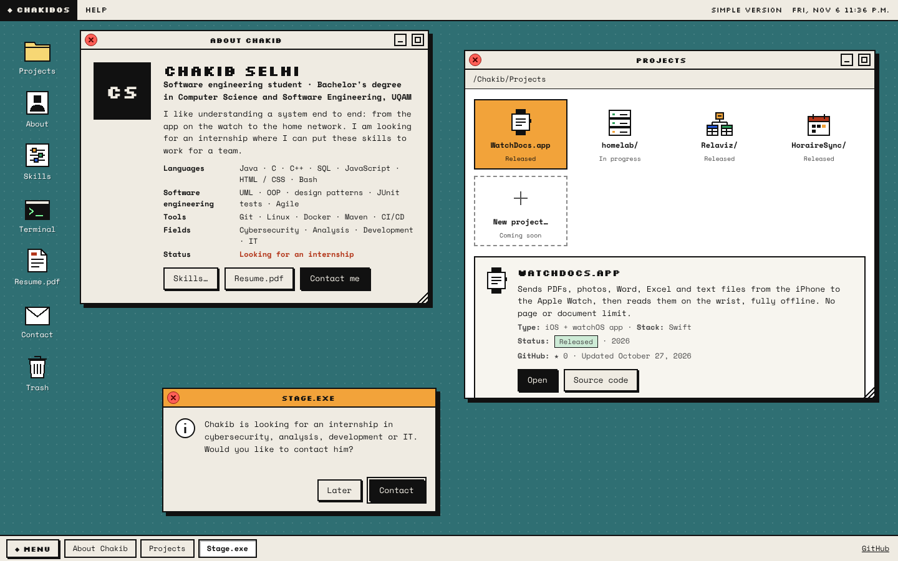 |

**Sur mobile**

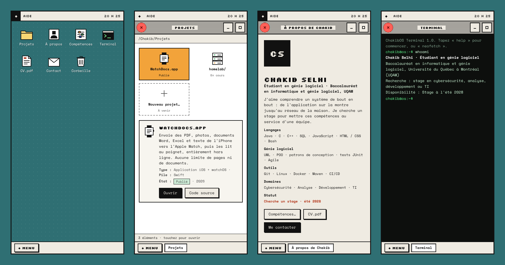

## Maquettes préliminaires

Avant de coder, j'ai exploré six concepts sur un canevas de design. Le concept **E · ChakibOS** a été retenu.
Ces maquettes montrent l'état des idées au départ : certaines informations ont changé depuis.

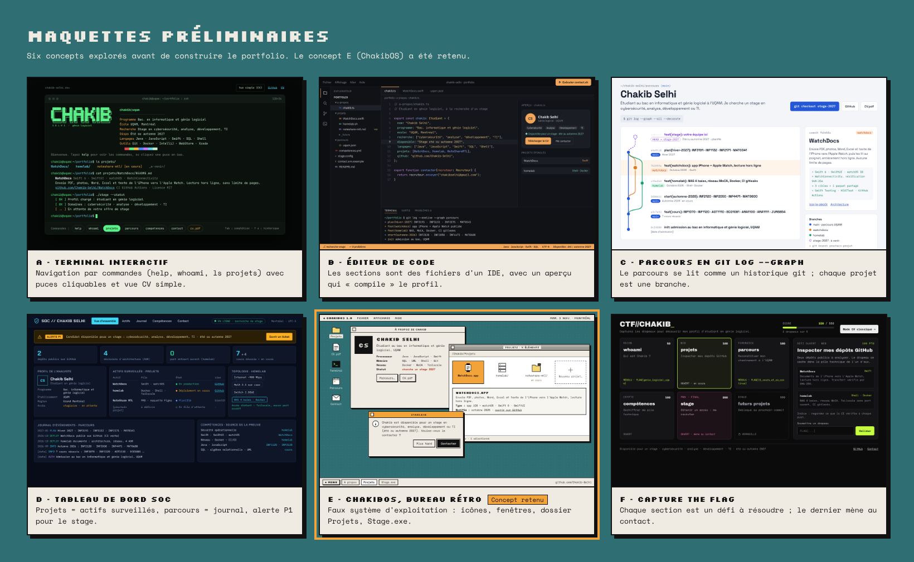

| Concept | Idée |
|---|---|
| [A · Terminal interactif](docs/concepts/A-terminal.png) | Navigation par commandes, avec des puces cliquables pour les recruteurs |
| [B · Éditeur de code](docs/concepts/B-editeur-de-code.png) | Les sections sont des fichiers d'un IDE |
| [C · Git graph](docs/concepts/C-git-graph.png) | Le parcours se lit comme un historique git |
| [D · Tableau de bord SOC](docs/concepts/D-tableau-de-bord-soc.png) | Un centre des opérations de sécurité |
| [E · ChakibOS](docs/concepts/E-chakibos.png) | Un faux système d'exploitation rétro (retenu) |
| [F · Capture the Flag](docs/concepts/F-capture-the-flag.png) | Chaque section est un défi à résoudre |


## Structure

```
index.html      Bureau ChakibOS
simple.html     Version simple et imprimable du CV
css/os.css      Styles du bureau et des fenêtres
css/simple.css  Styles de la version simple
js/data.js      Contenu du portfolio (français et anglais)
js/i18n.js      Traductions de l'interface et changement de langue
js/github.js    Synchronisation des dépôts publics GitHub, rendu des README
js/icons.js     Icônes pixel (SVG)
js/cv.js        Rendu du CV (partagé par la fenêtre CV.pdf et simple.html)
js/apps.js      Applications : À propos, Projets, Compétences, Contact, CV, etc.
js/terminal.js  Terminal et ses commandes
js/os.js        Gestionnaire de fenêtres, menus, barre des tâches, démarrage
assets/         Favicon et captures d'écran des projets
.githooks/      Hook git : met à jour la version des fichiers CSS et JS à chaque commit
docs/           Captures d'écran du site et maquettes préliminaires
```

## Mes autres projets

- [WatchDocs](https://github.com/Chakib-Selhi/WatchDocs) : documents de l'iPhone vers l'Apple Watch, lecture hors ligne (Swift, SwiftUI, watchOS).
- [homelab](https://github.com/Chakib-Selhi/homelab) : NAS, services Docker et sécurité opérationnelle, documentés de bout en bout.
